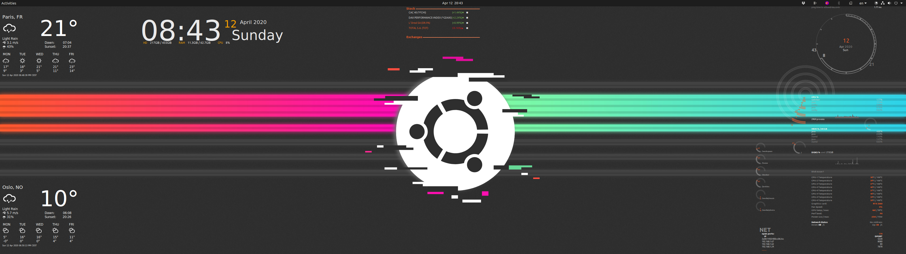

# [](https://github.com/AlbanAndrieu) MyConkyConfig

This file was generated by Ansigenome. Do not edit this file directly but instead have a look at the files in the ./meta/ directory.

[](http://www.apache.org/licenses/LICENSE-2.0.html)
[](https://github.com/AlbanAndrieu/MyConkyConfig/tree/master)
[](#)


Another [conky](https://github.com/brndnmtthws/conky) configuration skin showing system informations, weather, Market Indexes and Exchange Rates.
Based on [MyConkyConfig](https://github.com/rpungartnik/MyConkyConfig/)

* [Installation](#installation)
* [System Information](#system-information)
* [Weather](#weather)
* [API-key](#api-key)
* [City](#city)
* [Language](#language)
* [Markets](#markets)
* [Homelab](#homelab)
* [Checks](#checks)
* [Requisites](#requisites)
* [Images](#images)

---

[](https://github.com/AlbanAndrieu/MyConkyConfig/blob/master/screenshot.png)

---

## Help

[conky_scripts_systeme](https://doc.ubuntu-fr.org/conky_scripts_systeme)
[variables](https://linuxpedia.fr/doku.php/personaliser/conky/variables)

## Installation
After downloading the project, move conky folder to you ~ dir.

```
$ mv conky ~/.conky
```

Inside .conky fonder you will find the script startconky.sh you can use to start conky on your system.

---

## Skins
### System Information
Show some important informations about system health.

### Weather
Show current weather conditions using [OpenWeatherMap](http://openweathermap.org/).

This skin was based on [Harmattan](https://github.com/zagortenay333/Harmattan) configuration.

#### Configuration
##### API Key
Register a private API key on [OpenWeatherMap](http://openweathermap.org/) to get weather data.

Keep the API key out of this public repository, in a private file read by the `get_weather*` scripts:

```
$ mkdir -p ~/.config/conky && (umask 077; echo YOUR_KEY > ~/.config/conky/openweathermap.key)
```

##### City

[Find the ID of your city](http://bulk.openweathermap.org/sample/) and place it inside the `template7` variable inside the `conkyrc_weather` file.

##### Language

By default this conky will use your default locale.

Edit the `template9` variable in the `conkyrc_weather` file to change the language.

[See the list of supported languages](http://openweathermap.org/current#multi)

### Markets
`conky_market` shows TotalEnergies, the CAC 40, the DAX, two DAX trackers and Bitcoin with the day and one-year
change and a one-year sparkline, from the Yahoo Finance chart API. Edit the `quotes` list in `market.sh` to change them.

### Homelab
`conky_homelab` shows the pfSense gateway and WAN latency, TrueNAS CPU, memory and pools, the Prometheus targets
down, failing Gatus endpoints and the active Alertmanager alerts. Override `HOMELAB_PROMETHEUS`,
`HOMELAB_ALERTMANAGER` or `HOMELAB_GATEWAY` in `homelab.sh` for another network.

## Checks

```
$ sudo apt install lua5.4      # luac
$ mise install && mise run hooks
$ mise run validate            # every config started by startconky.sh compiles, its helpers exist
$ mise run check               # all pre-commit hooks
```

## Requisites:
 * [conky](https://github.com/brndnmtthws/conky) >= 1.10
 * [Font Awesome](https://github.com/FortAwesome/Font-Awesome)
 * Pyton
 * [cairo](https://www.cairographics.org/download/)
 * [font-awesome](https://askubuntu.com/questions/700229/how-can-i-display-font-awesome-fonts-in-character-map)
 * [font](http://epsi-rns.github.io/desktop/2018/02/04/installing-font.html)

```
$ sudo apt install python3-minimal
```

 * Curl

```
$ sudo apt install curl
```

 * jq

```
$ sudo apt install jq
```

 * cairo

```
$ sudo apt-get install libcairo2-dev
```

 * awesome

```
$ sudo apt-get install fonts-font-awesome
$ fc-list | grep -i awesome
```

 * other

```
$ sudo apt-get install nvidia-utils-550-server lm-sensors

$ gucharmap
$ sudo apt install libatasmart-bin
$ sudo apt install smartmontools
# ln -s /workspace/users/albandrieu30/MyConkyConfig/conky ~/.conky
```
